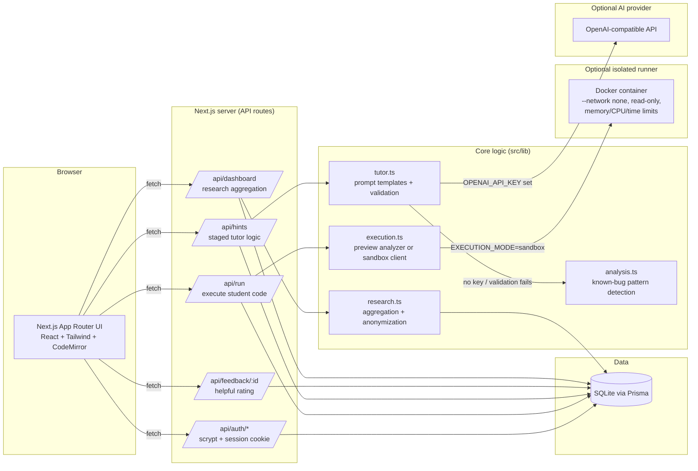

# SelamCode

**An AI-assisted debugging tutor that helps beginner programmers understand and fix their own code — and refuses to simply hand over the answer.**

Built as a student research prototype for beginner Python learners in Ethiopia and other low-resource learning environments, where a tutor's time is scarce but curiosity isn't.

---

## Problem statement

Beginner programmers who hit a bug have two common paths available to them today: struggle alone for hours with no guide, or paste the broken code into a general-purpose AI assistant and receive a complete, rewritten solution in seconds. Neither path teaches debugging. The first wastes time and erodes confidence; the second quietly removes the exact cognitive work — tracing execution, forming a hypothesis, testing it — that makes someone a better programmer.

This problem is sharper in low-resource learning environments, where instructor time per student is limited, class sizes are large, and students may not have ready access to a mentor who can sit beside them and ask "what did you expect this line to do?" An AI tutor could fill that gap, *if* it is designed to ask rather than answer.

## Research motivation

SelamCode exists to explore one question: **can a staged, Socratic hint system meaningfully change how beginners approach debugging, without collapsing into "just show me the code"?**

The design encodes a single non-negotiable principle: **help students understand and fix their own code; never give the full corrected solution by default.** Every hint request is logged, every hint can be rated helpful or not, and an instructor-facing research view aggregates (anonymized) real activity — never fabricated metrics — so the question above can actually be studied over time.

This is a prototype, not a validated pedagogical intervention. It does not claim to have proven a learning gain.

## Key features

- **Six-stage progressive hint system** — Understand → Locate → Concept → Direction → Specific → Optional fix, each stage unlocked only after the previous one, each independently rateable.
- **Three hint categories** — planning, debugging, and optimization/readability — so a learner can ask for the *kind* of help they actually want.
- **A possible fix is never automatic.** The "Show possible fix" stage requires explicit confirmation and returns a minimal unified diff with an explanation, never a full rewritten solution.
- **Amharic support with an honest fallback.** A learner can toggle Amharic explanations. If a reliable Amharic hint can't be produced, the app falls back to English and says so, rather than guessing.
- **8 built-in Python exercises**, each with a realistic beginner bug, 4+ test cases (some hidden), concept tags, and difficulty ratings.
- **CodeMirror-based Python editor** with run/submit, stdout/error display, and visible + hidden test results.
- **Two execution modes:** a safe, clearly labeled *local preview mode* (static pattern analysis, no code execution) by default, and an optional *sandboxed Docker runner* with no network access, a read-only filesystem, and strict memory/CPU/time limits.
- **Instructor research dashboard** (`/dashboard`) — real totals, hint-category breakdowns, helpful/not-helpful ratings, common error categories, average hints before a verified solve, and an anonymized recent-submissions table. No seeded or fabricated activity.
- **Email/password auth** with scrypt-hashed passwords — no OAuth, by design.

## Screenshots

> _Add real screenshots after running the app locally — placeholders below._

| Landing page | Practice workspace | Research dashboard |
| --- | --- | --- |
| `docs/screenshots/landing.png` | `docs/screenshots/workspace.png` | `docs/screenshots/dashboard.png` |

## Architecture



### Why these choices

- **Local preview mode by default.** Running arbitrary student Python on the same host as the web server is a real security risk. SelamCode defaults to a static, clearly labeled "local preview" analyzer so the full experience works out of the box with zero extra setup. Real execution is available through an isolated, resource-limited, network-disabled Docker container (`python/Dockerfile`) when you opt in.
- **AI responses are validated, not trusted blindly.** Every AI-generated hint is checked for word count, Amharic script (when requested), absence of full code before the reveal stage, and — at reveal — a small, structurally valid unified diff that actually applies to the student's code. If validation fails, SelamCode falls back to curated offline hint templates rather than risk leaking a full solution.
- **No OAuth.** Simple, auditable email/password auth with scrypt hashing keeps the authentication surface small and dependency-free for a research prototype.

## Tech stack

- **Frontend:** Next.js 15 (App Router) + TypeScript + Tailwind CSS + shadcn/ui-style components
- **Code editor:** CodeMirror 6 (`@uiw/react-codemirror`) with Python syntax highlighting
- **Backend:** Next.js API routes
- **Database:** SQLite via Prisma ORM (driver adapter: `@prisma/adapter-libsql`)
- **Auth:** email/password, scrypt password hashing, signed session cookies — no OAuth
- **AI:** any OpenAI-compatible chat completions API, configured via `OPENAI_API_KEY`
- **Code execution:** labeled local preview analyzer by default; optional isolated Docker sandbox (`python/`)
- **Validation:** Zod on every API route
- **Testing:** Vitest (60 tests across validation, auth, analysis, execution, tutor logic, and research aggregation) + a Python `unittest` suite for the sandbox runner

## Local setup

### Prerequisites

- Node.js 20.19+ and npm
- Python 3.10+ (only needed if you build the optional sandbox runner tests)
- Docker (optional, only for real Python execution via `EXECUTION_MODE=sandbox`)

### Install and run

```bash
git clone <this-repo-url> selamcode
cd selamcode
npm install
cp .env.example .env        # then edit values as needed (see below)
npm run db:generate
npm run db:migrate          # creates/updates prisma/dev.db from the schema
npm run db:seed             # loads the 8 built-in exercises
npm run dev
```

Visit `http://localhost:3000`.

By default:
- `EXECUTION_MODE=preview` — code "runs" against a safe static analyzer and clearly labels results as local preview estimates.
- No `OPENAI_API_KEY` — hints are generated from curated offline tutor templates (also clearly labeled).

### Trying it without creating an account

Set `DEMO_AUTH_ENABLED=true` and `SEED_DEMO_ACCOUNTS=true` in `.env` (local development only — never on a public deployment), set a `DEMO_PASSWORD`, then re-run `npm run db:seed`. The login/register pages will show one-click demo sign-in for a student and an instructor account.

## Environment variables

See `.env.example` for the full list with inline explanations. Highlights:

| Variable | Purpose |
| --- | --- |
| `DATABASE_URL` | SQLite connection string, e.g. `file:./dev.db` |
| `OPENAI_API_KEY` | Enables live AI hints via an OpenAI-compatible API; omit to use offline templates |
| `OPENAI_BASE_URL` / `OPENAI_MODEL` | Point at any OpenAI-compatible provider/model |
| `EXECUTION_MODE` | `preview` (default, safe static analysis) or `sandbox` (isolated Docker execution) |
| `SANDBOX_IMAGE` / `EXECUTION_TIMEOUT_MS` | Configure the sandbox runner image and per-run timeout |
| `DEMO_AUTH_ENABLED` / `SEED_DEMO_ACCOUNTS` / `DEMO_PASSWORD` | Local-only demo accounts; must be explicitly enabled |
| `INSTRUCTOR_INVITE_CODE` | Required to self-register as an instructor |
| `RESEARCH_SALT` | Secret salt used to anonymize student IDs in the dashboard |
| `SESSION_COOKIE_SECURE` | Set `false` only for local HTTP development |

## Database migrations

Prisma manages the schema (`prisma/schema.prisma`) and migration history (`prisma/migrations/`).

```bash
npm run db:migrate     # create/apply a migration in development
npm run db:deploy      # apply existing migrations (production/CI)
npm run db:seed        # (re-)load the 8 built-in exercises; idempotent
npm run db:studio      # browse the database with Prisma Studio
```

## Running the tests

```bash
npm test               # Vitest: 60 tests across lib/ modules
npm run typecheck
npm run lint

python3 -m unittest discover -s python -p "test_*.py" -v   # sandbox runner tests
```

## Enabling real Python execution (optional)

By default, SelamCode never executes arbitrary student code on the host. To enable real, isolated execution:

```bash
docker build -t selamcode-python:latest ./python
```

Then set `EXECUTION_MODE=sandbox` in `.env`. Each run spawns a disposable container with `--network none`, a read-only filesystem, dropped capabilities, and memory/CPU/process/time limits (see `src/lib/execution.ts` and `python/runner.py`).

## Deployment

### Docker Compose (simplest local or small-server deployment)

```bash
cp .env.example .env   # fill in real values; set a strong RESEARCH_SALT
docker compose up --build
```

This builds the web app, runs migrations and seeding on container start, and persists the SQLite database in a named volume. To enable sandboxed execution in Compose, build `python/Dockerfile` as `selamcode-python:latest` and uncomment the Docker socket mount in `docker-compose.yml`.

### Vercel

1. Push this repository to GitHub.
2. Import it into Vercel.
3. Because Vercel's serverless filesystem is ephemeral, point `DATABASE_URL` at a hosted SQLite-compatible database (e.g. [Turso](https://turso.tech)) rather than a local file — the Prisma `libsql` driver adapter already used here supports this with no code changes.
4. Set the remaining environment variables from `.env.example` in the Vercel project settings.
5. Run `npm run db:deploy && npm run db:seed` against the production database once (e.g. via a one-off Vercel CLI command or GitHub Action).
6. `EXECUTION_MODE=sandbox` requires a container runtime Vercel's serverless functions don't provide — on Vercel, keep `EXECUTION_MODE=preview`, or run the sandbox execution path on a separate host (e.g. Render) and proxy to it.

### Render

Render's persistent-disk web services support Docker directly:

1. Create a new Web Service from this repository, choose "Docker" as the environment.
2. Attach a persistent disk mounted at `/data` and set `DATABASE_URL=file:/data/selamcode.db`.
3. Set the remaining environment variables from `.env.example`.
4. For real Python execution, add a Render private service running `python/Dockerfile`, or enable Docker-in-Docker on the main service and set `EXECUTION_MODE=sandbox`.

## Future research ideas

- Compare learning outcomes between staged hints and a single "just tell me" baseline, measured by independent debugging success on a held-out exercise.
- Study whether the *order* of planning vs. debugging vs. readability hints changes how often students self-correct.
- Measure whether Amharic-language hints change completion rates or hint-request frequency for Amharic-speaking learners.
- Track whether students who view "Show possible fix" are more or less likely to pass the next, unrelated exercise unaided.
- Extend hidden test case design to probe specific misconceptions (e.g. off-by-one errors, mutable default arguments) and tag hint helpfulness against misconception type.

## Ethical note

SelamCode intentionally makes it *harder* to get a complete answer. The reveal stage is gated behind five other stages and an explicit click, and even then shows a minimal diff with an explanation rather than a full rewrite. This is a deliberate design choice, not a missing feature: the goal is to support learning, not to optimize for the fastest possible "correct" submission. Student code, hint requests, and ratings are stored to support this research goal; the instructor dashboard anonymizes student identities, and no seeded, fake, or illustrative activity is ever mixed into real research data.

---

## How to demo this in a scholarship interview

1. **Start with the principle, not the product.** Open `/about` and read the one-sentence philosophy aloud: *"Help students understand and fix their own code; never give the full corrected solution by default."* Explain that every subsequent design decision traces back to this sentence.
2. **Show the staged hint system live.** Go to `/practice/fizzbuzz`, run the buggy starter code, and request hints one at a time — point out that "Locate" tells you *where* to look without saying *what's wrong*, and that "Show possible fix" is a separate, deliberate, confirmable action with a minimal diff rather than a rewritten function.
3. **Toggle Amharic.** Flip the Amharic switch on a hint to show bilingual accessibility, and mention the honest-fallback behavior if Amharic isn't reliably available.
4. **Rate a hint, then open `/dashboard`.** Show that the rating you just submitted is reflected in real, live numbers — not a mocked chart — and explain that this is the actual research instrument: which hint types help, and how often.
5. **Talk about the safety design.** Mention that student code never runs unchecked on the server by default (local preview mode), and that the optional sandbox is network-isolated with strict resource limits — this shows systems-level thinking, not just UI polish.
6. **Close with the research question.** Reiterate that this is a prototype built to *ask* a question — which kinds of hints actually help beginners learn to debug — not to claim it already has the answer.
